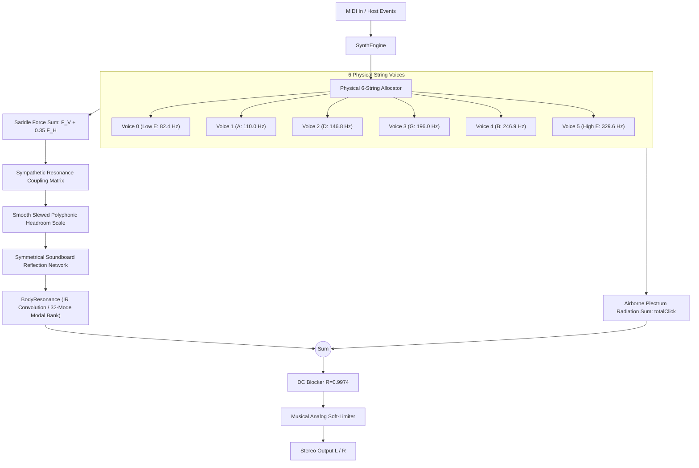

# 01 — Architecture Overview

## 1. System Pipeline & Signal Flow

The synthesizer simulates a complete physical guitar system: plectrum/finger interaction $\to$ vibrating multi-string grid $\to$ bridge saddle coupling $\to$ unplayed open string sympathetic resonance $\to$ guitar body soundboard radiation $\to$ direct airborne acoustic radiation.

---

### Sample-Accurate MIDI (v64.f)
`HybridSynthProcessor::processBlock` converts the host `MidiBuffer` into timestamped `SynthEngine::Event`s (NoteOn / NoteOff / AllNotesOff) in a fixed 512-entry queue, and calls `SynthEngine::process(L, R, n, events, numEvents)`. The engine applies each event at its exact sample inside the per-sample voice loop. The body convolution runs after that loop on the whole block; it is linear, so it needs no splitting.
- If a block carries more than 512 events, the processor renders up to the overflowing event's position and continues with an empty queue, so it never allocates.
- `render_audio` delivers its scheduled events the same way.
- Before v64.f every event was applied at sample 0 of its block: up to 10.7 ms of timing error at 512 samples / 48 kHz. Fast passages inside one block also collapsed to the same onset, which defeated the legato onset-age guard.
- **All Notes Off / All Sound Off / Reset All Controllers** call `SynthEngine::allNotesOff()` at their timestamp. It stops all strings and clears held notes, keyswitches and pending strum plucks, but lets the body, reflection and DC-filter tails decay. Before v64.f these triggered a full `reset()` at the start of the block.
- `bench_synth` verifies timing: a note at offset *k* of a 512-sample block must match the same note at the start of a block *k* samples later (measured rel. difference ~3×10⁻⁷).

## 2. Physical 6-String Layout & Voice Allocation

Unlike standard electronic synthesizers with generic round-robin voice stealing, this synthesizer models a **real physical 6-string guitar**:
- **String 0**: Low E ($E_2$, MIDI 40, $82.41\text{ Hz}$) — wound phosphor bronze / silverplated nylon
- **String 1**: A ($A_2$, MIDI 45, $110.00\text{ Hz}$) — wound phosphor bronze / silverplated nylon
- **String 2**: D ($D_3$, MIDI 50, $146.83\text{ Hz}$) — wound phosphor bronze / silverplated nylon
- **String 3**: G ($G_3$, MIDI 55, $196.00\text{ Hz}$) — wound phosphor bronze or plain wire
- **String 4**: B ($B_3$, MIDI 59, $246.94\text{ Hz}$) — plain steel or rectified nylon
- **String 5**: High E ($E_4$, MIDI 64, $329.63\text{ Hz}$) — plain steel or rectified nylon

### Voice Assignment
**Single notes** (`assignStringForNote`):
- A note goes to its natural first-position string. If that string is busy, it goes to an idle string that can fret it within the **22-fret** neck (`kMaxFret`; 19 before v65.f), choosing the lowest fret.
- If no idle string can fret it: with **Strict Fretboard** off, an idle string past the fretboard is used; otherwise the natural string is re-plucked.

**Simultaneous notes** (same sample, e.g. a piano-roll chord; v65.f/v73.f, `assignChordStrings`):
- Assigned **jointly** by exhaustive search over note→string maps: at most 13,327 for 6 notes, stack-only, audio-thread safe. In priority order, it maximises:
  1. notes at a physical position (fret 0–22);
  2. notes placed at all (only with Strict Fretboard off);
  3. a compact hand span (`-span`, human fretting ergonomics);
  4. low frets (`-fretSum`, standard guitar chord voicings);
  5. untouched ringing strings (`-ringingUsed`, tie-breaker only; prior to v73.f, this preceded hand span, causing chord transitions like C $\to$ C# to contort across 11 frets and drop the top F note).
- The auto-strum and `noteOnChord` both use this solver without artificial avoidance of released strings (`avoidRinging = false`), preserving consistent acoustic voicings.
- Single notes (`assignStringForNote`) reuse their natural string immediately when the previous note on that string is no longer held down (`heldNotes[oldNote] <= 0.001f`), naturally damping release tails and preserving melodic register.
- Before v65.f, notes were placed greedily in arrival order with a 19-fret limit, and a note with no free string re-plucked an occupied one. C5–E5–G5–B5–D6 (FL: C6–E6–G6–B6–D7) played only E5 and D6.
- Within one sample, note-offs and keyswitches are applied before the chord's note-ons, so a keyswitch on the same tick affects the chord.
- **Strict Fretboard** (`strictFretboard`, default off):
  - *On*: notes with no physical position are dropped, as on a real guitar. The example plays 4 of 5 notes, since B5 and D6 both need the high E string.
  - *Off*: such notes take a free string past the fretboard, so up to 6 notes always sound. They are voiced with the gauge of the note's natural string (`Voice::noteOn(..., geometryString)`), so they sound like a normally fretted note rather than an over-tensioned wound string.
- **Decaying String Re-Trigger Protection (v45.f)**: If an incoming chord note targets a physical string currently decaying in release, the allocator prioritizes truly idle strings to prevent audible voice-clobbering pops.

### Monophonic Lead Legato Routing Engine (v57.f–v58.f)
When the **Legato (HO/PO)** parameter (`legato`, default on, exposed in the GUI title bar and to the DAW since v64.f) is enabled, incoming notes in DAW piano rolls are evaluated for acoustic hammer-ons and pull-offs before string allocation:
1. **Monophonic State Verification**: Exactly 1 note must be currently held (`numCurrentlyHeld == 1`). If 2 or more notes are held, polyphonic chord behavior is preserved.
2. **Chord Window (v64.f)**: The held note must have started at least **40 ms** earlier (`SynthEngine::kLegatoChordWindowSec`, converted to samples at the current rate). Rolled or humanised keyboard chords spread their notes over ~10–40 ms and must stay chords; a legato note 40 ms after the previous one is already 25 notes/s. Onsets are sample-accurate, so the window is the same at every host buffer size. Before v64.f the window was 160 samples (~3.5 ms): the second note of a live chord within 3 semitones (e.g. E3 then G3, 8 ms apart) was turned into a hammer-on, and the chord lost a note.
3. **Physical Fretting Reach**: Legato triggers if the new note is on the same natural string ($\text{interval} \le 12$) OR within an adjacent cross-boundary melodic reach ($0 \le \text{fret} \le 19$, $\text{interval} \le 3$).
4. **Seamless Handover**: The active voice updates its fundamental pitch without pick transient click, and transfers `heldNotes` tracking so subsequent Note-Offs release cleanly.

---

## 3. Polyphonic Bridge Impedance & Headroom Scaling

When multiple strings vibrate simultaneously (e.g. strumming a 6-string chord), the physical downward bridge force increases substantially. A rigid bridge would cause intermodulation distortion (IMD) or hard ceiling clipping in the body resonator.

1. **Active Voice Headroom Scaling**:
   $$\text{targetPolyScale} = \frac{1}{\sqrt{1 + 0.70 \times (N_\text{active} - 1)}}$$
   For 1 voice: $1.000$; for 4 voices: $0.567$; for 6 voices: $0.471$.
2. **Smooth Slew Filter ($\tau \approx 15\text{ ms}$)**:
   $$\text{smoothedPolyScale} = \text{targetPolyScale} + e^{-1 / (\tau f_s)} \times (\text{smoothedPolyScale} - \text{targetPolyScale})$$
   Eliminates instantaneous zipper noise and amplitude stepping across strummed chord voicings.

---

## 4. Symmetrical Soundboard Reflection Network

To provide an authentic 3D wooden acoustic aura without phase cancellation or artificial panning:
- **Delay Taps**: $d_1 = 5.2\text{ ms}$ ($\sim 230$ samples at $44.1\text{k}$), $d_2 = 9.6\text{ ms}$ ($\sim 423$ samples).
- **Mirrored Symmetrical Matrix**:
  $$r_L = +0.22 \cdot \text{ref}_1 - 0.16 \cdot \text{ref}_2$$
  $$r_R = -0.16 \cdot \text{ref}_1 + 0.22 \cdot \text{ref}_2$$
- **Drive Signals**:
  $$\text{drive}_L = \text{monoBridge} + \text{width} \cdot r_L$$
  $$\text{drive}_R = \text{monoBridge} + \text{width} \cdot r_R$$
- **Acoustic Properties**:
  - Attack transient is bit-exact identical on L and R ($0.00\text{ dB}$ attack difference, perfectly centered fundamentals).
  - Perfect mono fold-down without comb-filtering coloration ($r_L + r_R = 0.06 \cdot (\text{ref}_1 + \text{ref}_2)$).

---

## 5. Direct Airborne Radiation Path

High-frequency plectrum snap and finger release cavitation ($4\text{--}16\text{ kHz}$) radiate through the air directly to the listener's ears without passing through the wooden soundboard lowpass filter.
- `Voice::tickPickClick()` runs synchronously in audio thread scratch buffers.
- Summed directly into stereo channels **after** `BodyResonance::processBlock()`, preserving full master saturation and DC blocking protection.

---

## 6. Factory Preset & Program Management Architecture (v59.f, updated v76.f)

To allow fast auditioning and seamless DAW session recall without manual parameter dialing:
1. **Host Program Protocol**:
   - `HybridSynthProcessor` exposes 12 factory programs (8 Acoustic + 4 Electric DI) across host DAW preset bars.
2. **Curated Physical Modeling Factory Presets**:
   - *Acoustic Presets*: Dreadnought Acoustic, Nylon Concert Classical, Flamenco Rasgueado, Fingerstyle Auditorium, Vintage Parlor Blues, 12-String Shimmer, Percussive Palm Chops, Warm Jazz Archtop.
   - *Electric Presets*: Strat Clean Funk DI, Texas Blues Lead, Les Paul Vintage Warmth, Bridge Humbucker Bite.
3. **Session State Persistence**:
   - `currentProgram` and all 22 parameters are serialized to XML in `getStateInformation()` and restored in `setStateInformation()`.

---

## 7. Dual Instrument Paradigms: Acoustic vs. Electric DI Mode (v76.f)

Starting in v76.f, the synthesizer provides two complete, dedicated physical modeling instrument paradigms toggled via the top-level **Acoustic / Electric** page switcher:

### 1. Signal Flow Divergence
- **Acoustic Guitar Mode**:
  Vibrating strings deliver force through the bridge saddle into unplayed open string sympathetic resonance $\to$ body soundboard IR convolution (or 32-mode modal bank) $\to$ direct airborne pick snap $\to$ DC blocker and master soft limiter.
- **Electric Guitar Mode (Pure DI Output)**:
  Electromagnetic pickups sense physical string transverse velocity $v(x_p, t) = \frac{\partial u}{\partial t}(x_p, t)$ directly above the pole pieces. The induced voltages sum across active vibrating strings into the passive guitar RLC resonant circuit ($L$, $R$, $C$, tone pot), completely bypassing the acoustic body IR and airborne pick snap. This delivers a pristine direct input (DI) signal ready to be plugged into external amp simulation software (Neural DSP, Guitar Rig, Amplitube, etc.). An optional Cab/Air 2nd-order lowpass filter (~4.8 kHz) can be engaged for smooth standalone headphone jamming.

### 2. Dedicated Two-Page GUI Architecture
- **Acoustic Page**: Shows String Material (Nylon/Steel), Body Model IR selector, Custom IR loader button, Body Size, and Body Coupling.
- **Electric Page**: Shows Guitar Model (1962 Stratocaster / 1959 Les Paul), Pickup Position (5-way Strat / 3-way LP selector), Pickup Type (Single-Coil / Humbucker), Tone Knob (RLC circuit sweep), and Cab/Air roll-off toggle.
- Both pages share physical string articulation controls (Palm Muting, Choke Dead Notes, Strumming, Legato Hammer-ons/Pull-offs, Decay, Brightness, Pick Position, and Inharmonic Stiffness).

