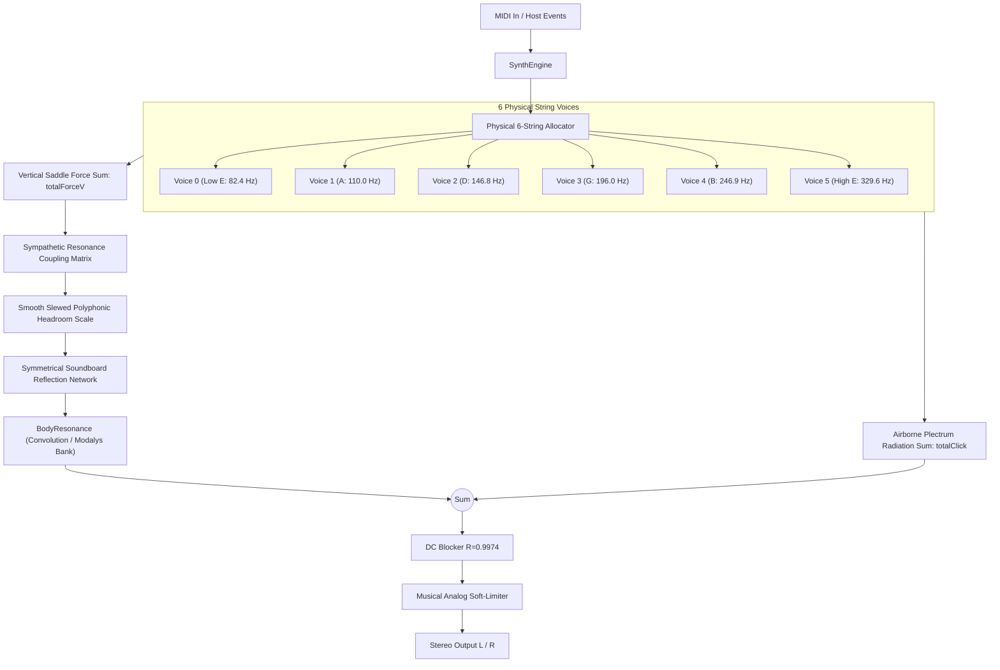

# 01 — Architecture Overview

## 1. System Pipeline & Signal Flow

The synthesizer simulates a complete physical guitar system: plectrum/finger interaction $\to$ vibrating multi-string grid $\to$ bridge saddle coupling $\to$ unplayed open string sympathetic resonance $\to$ guitar body soundboard radiation $\to$ direct airborne acoustic radiation.

---

## 2. Physical 6-String Layout & Voice Allocation

Unlike standard electronic synthesizers with generic round-robin voice stealing, this synthesizer models a **real physical 6-string guitar**:
- **String 0**: Low E ($E_2$, MIDI 40, $82.41\text{ Hz}$) — wound phosphor bronze / silverplated nylon
- **String 1**: A ($A_2$, MIDI 45, $110.00\text{ Hz}$) — wound phosphor bronze / silverplated nylon
- **String 2**: D ($D_3$, MIDI 50, $146.83\text{ Hz}$) — wound phosphor bronze / silverplated nylon
- **String 3**: G ($G_3$, MIDI 55, $196.00\text{ Hz}$) — wound phosphor bronze or plain wire
- **String 4**: B ($B_3$, MIDI 59, $246.94\text{ Hz}$) — plain steel or rectified nylon
- **String 5**: High E ($E_4$, MIDI 64, $329.63\text{ Hz}$) — plain steel or rectified nylon

### Voice Assignment (`assignStringForNote`)
- Each incoming MIDI note is assigned to the physical string that can fret it within a realistic hand span (up to 19 frets).
- If multiple strings can play a note, the allocator chooses an idle string closest to the current fretting position.
- **Decaying String Re-Trigger Protection (v45.f)**: If an incoming chord note targets a physical string currently decaying in release, the allocator prioritizes truly idle strings to prevent audible voice-clobbering pops.

### Monophonic Lead Legato Routing Engine (v57.f–v58.f)
When `paramLegatoEnabled` is true, incoming notes in DAW piano rolls are evaluated for acoustic hammer-ons and pull-offs before string allocation:
1. **Monophonic State Verification**: Exactly 1 note must be currently held (`numCurrentlyHeld == 1`). If 2 or more notes are held, polyphonic chord behavior is preserved.
2. **Onset Age Guard**: The held note must have been sounding for $\ge 160$ samples ($\sim 4\text{ ms}$) to prevent near-simultaneous chord voicings from collapsing.
3. **Physical Fretting Reach**: Legato triggers if the new note is on the same natural string ($\text{interval} \le 12$) OR within an adjacent cross-boundary melodic reach ($0 \le \text{fret} \le 19$, $\text{interval} \le 3$).
4. **Seamless Handover**: The active voice updates its fundamental pitch without pick transient click, and transfers `heldNotes` tracking so subsequent Note-Offs release cleanly.

---

## 3. Polyphonic Bridge Impedance & Headroom Scaling

When multiple strings vibrate simultaneously (e.g. strumming a 6-string chord), the physical downward bridge force increases substantially. A rigid bridge would cause intermodulation distortion (IMD) or hard ceiling clipping in the body resonator.

1. **Active Voice Headroom Scaling**:
   $$\text{targetPolyScale} = \frac{1}{\sqrt{1 + 0.70 \times (N_\text{active} - 1)}}$$
   For 1 voice: $1.000$; for 4 voices: $0.567$; for 6 voices: $0.471$.
2. **Smooth Slew Filter ($\tau \approx 15\text{ ms}$)**:
   $$\text{smoothedPolyScale} = \text{targetPolyScale} + e^{-1 / (\tau f_s)} \times (\text{smoothedPolyScale} - \text{targetPolyScale})$$
   Eliminates instantaneous zipper noise and amplitude stepping across strummed chord voicings.

---

## 4. Symmetrical Soundboard Reflection Network

To provide an authentic 3D wooden acoustic aura without phase cancellation or artificial panning:
- **Delay Taps**: $d_1 = 5.2\text{ ms}$ ($\sim 230$ samples at $44.1\text{k}$), $d_2 = 9.6\text{ ms}$ ($\sim 423$ samples).
- **Mirrored Symmetrical Matrix**:
  $$r_L = +0.22 \cdot \text{ref}_1 - 0.16 \cdot \text{ref}_2$$
  $$r_R = -0.16 \cdot \text{ref}_1 + 0.22 \cdot \text{ref}_2$$
- **Drive Signals**:
  $$\text{drive}_L = \text{monoBridge} + \text{width} \cdot r_L$$
  $$\text{drive}_R = \text{monoBridge} + \text{width} \cdot r_R$$
- **Acoustic Properties**:
  - Attack transient is bit-exact identical on L and R ($0.00\text{ dB}$ attack difference, perfectly centered fundamentals).
  - Perfect mono fold-down without comb-filtering coloration ($r_L + r_R = 0.06 \cdot (\text{ref}_1 + \text{ref}_2)$).

---

## 5. Direct Airborne Radiation Path

High-frequency plectrum snap and finger release cavitation ($4\text{--}16\text{ kHz}$) radiate through the air directly to the listener's ears without passing through the wooden soundboard lowpass filter.
- `Voice::tickPickClick()` runs synchronously in audio thread scratch buffers.
- Summed directly into stereo channels **after** `BodyResonance::processBlock()`, preserving full master saturation and DC blocking protection.

---

## 6. Factory Preset & Program Management Architecture (v59.f)

To allow fast auditioning and seamless DAW session recall without manual 14-parameter dialing:
1. **Host Program Protocol**:
   - `HybridSynthProcessor` overrides `getNumPrograms()`, `getCurrentProgram()`, `setCurrentProgram(int index)`, and `getProgramName(int index)`.
   - DAW host wrappers (such as FL Studio's top preset bar, Logic Pro's preset manager, Cubase VST3 selector) automatically expose the 8 factory programs.
2. **Bi-Directional APVTS Parameter Notification**:
   - Program changes execute `param->setValueNotifyingHost(param->convertTo0to1(val))` across all APVTS parameters.
   - This atomically moves all attached rotary sliders, toggle buttons, and combo boxes in the custom GUI (`PluginEditor`) without thread contention or audio dropouts.
3. **Curated Physical Modeling Factory Presets**:
   - *Dreadnought Acoustic*: Steel, Gibson IR, full sustain, Bilbao FDTD.
   - *Nylon Concert Classical*: Nylon, Classical IR, soft plectrum contact, Bilbao FDTD.
   - *Flamenco Rasgueado*: Nylon, Classical IR, fast snappy attack, wide stereo.
   - *Fingerstyle Auditorium*: Steel, Gibson IR, high sustain, Digital Waveguide.
   - *Vintage Parlor Blues*: Steel, 32-mode Modal Bank, woody grit, Bilbao FDTD.
   - *12-String Shimmer*: Steel, Modal Bank, jumbo body, maximum stereo width, DWG.
   - *Percussive Palm Chops*: Steel, Gibson IR, palm mute active, tight acoustic chug.
   - *Warm Jazz Archtop*: Nylon, Modal Bank, deep warmth, gentle soundhole position.
4. **First-Launch Initialization Parity**:
   - The processor constructor explicitly executes `setCurrentProgram(0)` and sets APVTS layout defaults to match Preset 0 (*Dreadnought Acoustic*), guaranteeing that when the plugin is opened for the first time, all physical modeling DSP parameters match the displayed preset immediately.
5. **Session State Persistence**:
   - `currentProgram` is serialized to XML alongside the APVTS value tree in `getStateInformation()` and restored in `setStateInformation()`, ensuring host project recalls faithfully restore both the audio parameters and the active preset name.

