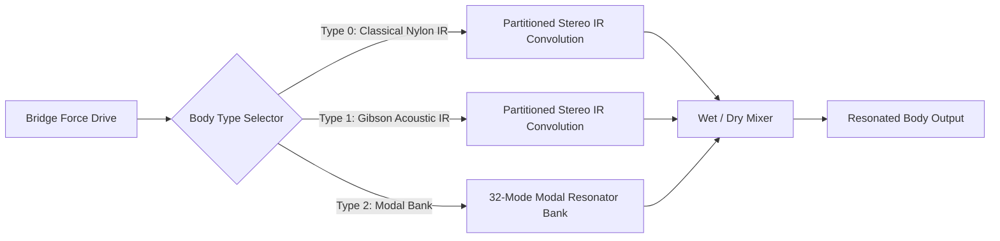

# 04 — Body, Bridge & Sympathetic Acoustics

## 1. Dual-Axis Saddle Force Extraction

At the guitar bridge, strings terminate on a bone or synthetic saddle. Energy transfers into the soundboard via two orthogonal physical mechanisms:

1. **Vertical Force ($F_V$ — Soundboard Pumping)**:
   - Primary transverse string slope: $\partial u_V / \partial x$ at $x = L$.
   - **Phantom Tension Modulation ($2 f_0$)**: Dynamic tension variation $\Delta T(t)$ creates a non-linear longitudinal pull at double the fundamental frequency:
     $$F_\text{phantom}(t) \propto \left( \frac{\Delta T}{T_0} \right) \cdot \text{coupling}$$
   - **Axial Longitudinal P-Wave Attack Snap**: Compressional waves traveling at acoustic speed of sound in string material ($c_L = \sqrt{E/\rho} \approx 1025\text{ m/s}$ in nylon, $\sim 5050\text{ m/s}$ in steel) create a sharp 15–25 ms attack impulse.
   - Terminated by a calibrated 2-pole lowpass filter modeling the bone saddle mechanical impedance ($f_c \approx 3.5\text{--}7.0\text{ kHz}$).
2. **Horizontal Force ($F_H$ — Lateral Rocking)**:
   - Lateral transverse string slope: $\partial u_H / \partial x$ at $x = L$.
   - Drives rocking torque around the bridge center axis.
   - `SynthEngine` sums $F_V + 0.35\,F_H$ (`kHorizontalSaddleCoupling`) into the single bridge drive that feeds the sympathetic bank and body. Before v62.f the $F_H$ term was dropped.

---

## 2. Multi-Port Cross-Bridge Sympathetic Resonance

When a note is plucked on an acoustic guitar, the bridge vibrates and drives the soundboard. In turn, the moving bridge feeds acoustic energy back into the remaining 5 unplayed strings.

### The Sympathetic Coupling Network (`SympatheticResonance.h`)
- Implemented as an energy-conserving multi-port scattering junction.
- Maintains 6 tuned parallel resonators corresponding to the open fundamental and overtone modes of the unplayed strings ($E_2, A_2, D_3, G_3, B_3, E_4$).
- **Fretted String Damping**: If a voice is actively fretting physical string $s$, its open-string speaking length is clamped, naturally damping that string's sympathetic mode. Once fully damped, that string's resonator state is **cleared**, not frozen (v63.f). Before v63.f the frozen energy rang out as a ghost tone of the open string when the voice ended (about −61 dB re. peak, ~40 dB under the note, on every release).
- **Mute Mode Coupling**: When palm or full mutes are active, sympathetic coupling is attenuated to match physical hand contact.
- **Coupling Factor ($0.12\times$)**: Calibrated so sparse voicings and open chords bloom with an authentic acoustic wooden halo.

---

## 3. Acoustic Soundboard & Body Resonator Models (`BodyResonance.cpp`)

The vertical bridge force drives the acoustic guitar soundboard, which transforms mechanical vibrations into airborne sound.

### 1. Partitioned Stereo IR Convolution
- **Gibson Dreadnought Acoustic IR**: Deep, resonant lower-bout cavity mode ($A_0 \approx 105\text{ Hz}$) and woody soundboard plate resonance ($T_1 \approx 200\text{ Hz}$). Wet gain calibrated to $0.82\times$.
- **Classical Nylon IR**: Prominent 210 Hz soundboard bloom with warm, intimate treble rolloff. Wet gain calibrated to $0.62\times$ to avoid soft-limiter saturation.
- Uses partitioned low-latency frequency-domain FFT convolution (zero latency in audio thread).
- Both embedded IRs are short: 2048 frames at 48 kHz ($\approx 43\text{ ms}$). Classical Nylon is stereo; Gibson is mono, used on both channels.
- **Known issue: notch at ~981 Hz in both IRs.** Measured on the IR files: −10.7 dB (Classical) and −7.8 dB (Gibson) re. the 300–3000 Hz median. B5 (988 Hz) comes out ~10 dB quieter than A5 or C6 through either IR, but not with the modal bank or the dry signal. Two different guitars sharing a notch at the same frequency suggests a capture artifact (e.g. a mic-position comb), not a body property. Not yet corrected.

### Body Model Switching (v62.f)
- Each IR has its own `juce::dsp::Convolution` engine, and **both are loaded in `init()` (`prepareToPlay`)**. Before v62.f a body change called `loadImpulseResponse()` + `prepare()` from `processBlock`, which allocated on the audio thread.
- Only the audible engine is processed. On a switch, `setParameters()` clears the incoming body (`Convolution::reset()`, or zeroing the modal filters), unless it is still sounding as the outgoing half of an unfinished crossfade. Output then crossfades linearly over 20 ms; during the fade both bodies run.
- `Convolution::reset()` only clears buffers (JUCE hands any retired engine to its background queue), so it is safe on the audio thread. The `bench_synth` event stress test checks this.

### 2. 32-Mode Parallel Modal Resonator Bank (Modalys-style)
The 32 modes (frequency, Q, gain, stereo tilt) are a **hand-authored table** in `BodyResonance.cpp`. They are not exported from IRCAM Modalys or a finite-element model. The comments cite typical guitar body mode ranges from Rossing (2010) and Fletcher & Rossing (1998). "Modalys-style" refers to the modal-synthesis approach.
- Synthesizes the soundboard plate transfer function through 32 parallel second-order modal filters:
  $$H_\text{body}(s) = \sum_{m=1}^{32} \frac{g_m \omega_m}{s^2 + 2 \zeta_m \omega_m s + \omega_m^2}$$
- **Body Size** (parameter) scales all modal frequencies continuously (parlor ↔ jumbo). A damping scale for the mode Q factors exists in `BodyResonance::setParameters()`, but it is fixed at 1.0 and not exposed as a parameter.

