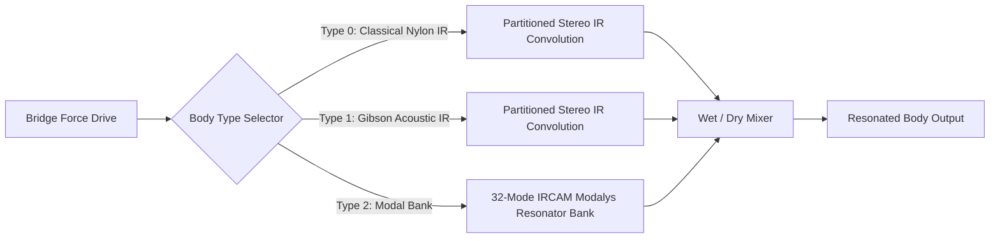

# 04 — Body, Bridge & Sympathetic Acoustics

## 1. Dual-Axis Saddle Force Extraction

At the guitar bridge, strings terminate on a bone or synthetic saddle. Energy transfers into the soundboard via two orthogonal physical mechanisms:

1. **Vertical Force ($F_V$ — Soundboard Pumping)**:
   - Primary transverse string slope: $\partial u_V / \partial x$ at $x = L$.
   - **Phantom Tension Modulation ($2 f_0$)**: Dynamic tension variation $\Delta T(t)$ creates a non-linear longitudinal pull at double the fundamental frequency:
     $$F_\text{phantom}(t) \propto \left( \frac{\Delta T}{T_0} \right) \cdot \text{coupling}$$
   - **Axial Longitudinal P-Wave Attack Snap**: Compressional waves traveling at acoustic speed of sound in string material ($c_L = \sqrt{E/\rho} \approx 1025\text{ m/s}$ in nylon, $\sim 5050\text{ m/s}$ in steel) create a sharp 15–25 ms attack impulse.
   - Terminated by a calibrated 2-pole lowpass filter modeling the bone saddle mechanical impedance ($f_c \approx 3.5\text{--}7.0\text{ kHz}$).
2. **Horizontal Force ($F_H$ — Lateral Rocking)**:
   - Lateral transverse string slope: $\partial u_H / \partial x$ at $x = L$.
   - Drives rocking torque around the bridge center axis.

---

## 2. Multi-Port Cross-Bridge Sympathetic Resonance

When a note is plucked on an acoustic guitar, the bridge vibrates and drives the soundboard. In turn, the moving bridge feeds acoustic energy back into the remaining 5 unplayed strings.

### The Sympathetic Coupling Network (`SympatheticResonance.h`)
- Implemented as an energy-conserving multi-port scattering junction.
- Maintains 6 tuned parallel resonators corresponding to the open fundamental and overtone modes of the unplayed strings ($E_2, A_2, D_3, G_3, B_3, E_4$).
- **Fretted String Damping**: If a voice is actively fretting physical string $s$, its open-string speaking length is clamped, naturally damping that string's sympathetic mode.
- **Mute Mode Coupling**: When palm or full mutes are active, sympathetic coupling is attenuated to match physical hand contact.
- **Coupling Factor ($0.12\times$)**: Calibrated so sparse voicings and open chords bloom with an authentic acoustic wooden halo.

---

## 3. Acoustic Soundboard & Body Resonator Models (`BodyResonance.cpp`)

The vertical bridge force drives the acoustic guitar soundboard, which transforms mechanical vibrations into airborne sound.

### 1. Partitioned Stereo IR Convolution
- **Gibson Dreadnought Acoustic IR**: Deep, resonant lower-bout cavity mode ($A_0 \approx 105\text{ Hz}$) and woody soundboard plate resonance ($T_1 \approx 200\text{ Hz}$). Wet gain calibrated to $0.82\times$.
- **Classical Nylon IR**: Prominent 210 Hz soundboard bloom with warm, intimate treble rolloff. Wet gain calibrated to $0.62\times$ to avoid soft-limiter saturation.
- Uses partitioned low-latency frequency-domain FFT convolution (zero latency in audio thread).

### 2. 32-Mode IRCAM Modalys Parallel Resonator Bank
- Synthesizes the soundboard plate transfer function through 32 parallel second-order modal filters:
  $$H_\text{body}(s) = \sum_{m=1}^{32} \frac{g_m \omega_m}{s^2 + 2 \zeta_m \omega_m s + \omega_m^2}$$
- Allows real-time continuous morphing of **Body Size** (transposing modal frequencies up/down) and **Body Decay** (adjusting wood air loss and damping).

