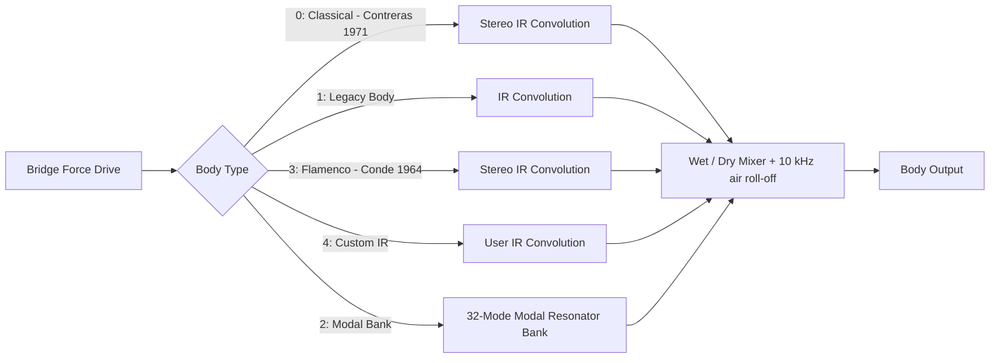

# 04 — Body, Bridge & Sympathetic Acoustics

## 1. Dual-Axis Saddle Force Extraction

At the guitar bridge, strings terminate on a bone or synthetic saddle. Energy transfers into the soundboard via two orthogonal physical mechanisms:

1. **Vertical Force ($F_V$ — Soundboard Pumping)**:
   - Primary transverse string slope: $\partial u_V / \partial x$ at $x = L$.
   - **Phantom Tension Modulation ($2 f_0$)**: Dynamic tension variation $\Delta T(t)$ creates a non-linear longitudinal pull at double the fundamental frequency:
     $$F_\text{phantom}(t) \propto \left( \frac{\Delta T}{T_0} \right) \cdot \text{coupling}$$
   - **Axial Longitudinal P-Wave Attack Snap**: Compressional waves traveling at acoustic speed of sound in string material ($c_L = \sqrt{E/\rho} \approx 1025\text{ m/s}$ in nylon, $\sim 5050\text{ m/s}$ in steel) create a sharp 15–25 ms attack impulse.
   - Terminated by a calibrated 2-pole lowpass filter modeling the bone saddle mechanical impedance ($f_c \approx 3.5\text{--}7.0\text{ kHz}$).
2. **Horizontal Force ($F_H$ — Lateral Rocking)**:
   - Lateral transverse string slope: $\partial u_H / \partial x$ at $x = L$.
   - Drives rocking torque around the bridge center axis.
   - `SynthEngine` sums $F_V + 0.35\,F_H$ (`kHorizontalSaddleCoupling`) into the single bridge drive that feeds the sympathetic bank and body. Before v62.f the $F_H$ term was dropped.

---

## 2. Multi-Port Cross-Bridge Sympathetic Resonance

When a note is plucked on an acoustic guitar, the bridge vibrates and drives the soundboard. In turn, the moving bridge feeds acoustic energy back into the remaining 5 unplayed strings.

### The Sympathetic Coupling Network (`SympatheticResonance.h`)
- Implemented as an energy-conserving multi-port scattering junction.
- Maintains 6 tuned parallel resonators corresponding to the open fundamental and overtone modes of the unplayed strings ($E_2, A_2, D_3, G_3, B_3, E_4$).
- **Fretted String Damping**: If a voice is actively fretting physical string $s$, its open-string speaking length is clamped, naturally damping that string's sympathetic mode. Once fully damped, that string's resonator state is **cleared**, not frozen (v63.f). Before v63.f the frozen energy rang out as a ghost tone of the open string when the voice ended (about −61 dB re. peak, ~40 dB under the note, on every release).
- **Mute Mode Coupling**: When palm or full mutes are active, sympathetic coupling is attenuated to match physical hand contact.
- **Coupling Factor ($0.12\times$)**: Calibrated so sparse voicings and open chords bloom with an authentic acoustic wooden halo.

---

## 3. Acoustic Soundboard & Body Resonator Models (`BodyResonance.cpp`)

The vertical bridge force drives the acoustic guitar soundboard, which transforms mechanical vibrations into airborne sound.

The body-type index is the saved `bodyModel` parameter value. **Never reorder; only append.** 0–2 kept their positions in v68.f, so older presets and projects map to the same slots.

### 1. IR Bodies (v68.f)
| # | Body | Source | IR |
| :-- | :--- | :--- | :--- |
| 0 | **Classical – Contreras 1971** | Manuel Contreras, Madrid 1971, classical (cedar/Rio palisander), measured in an anechoic lab | true stereo, 300 ms, 48 kHz |
| 1 | **Legacy Body** | Unknown origin (added Sept 2026 by an AI agent; formerly "Gibson Acoustic") | mono, 43 ms |
| 3 | **Flamenco – Conde 1964** | Faustino Conde, Madrid 1964, flamenca negra (spruce/Rio palisander), anechoic lab | true stereo, 300 ms, 48 kHz |
| 4 | **Custom IR** | user-loaded file (see below) | up to 2 s, mono or stereo |

- **Measured IRs (0 and 3)** come from R. Mores' guitar archive (Zenodo, [doi:10.5281/zenodo.4604577](https://doi.org/10.5281/zenodo.4604577), **CC BY 4.0**). An impact hammer struck the bridge centre, and two microphones 10 cm above the top plate (bass side → L, treble side → R, 20 cm apart) recorded the result. The IR is the mic signal divided by the hammer force, which is exactly the synth's bridge-force → sound path.
  - Usable bandwidth is 10–13 kHz; the body ring decays to −60 dB in ~190 ms.
  - Derivation script: `benchmarks/extract_mores_irs.py`. Credits and the list of changes: `resources/ir/ATTRIBUTION.md`.
- **Compared to the Legacy IR** (same phrase, long-term spectrum): about 11 dB less 80–160 Hz and 5–6 dB more 320–640 Hz, i.e. less boom and more woody low-mid. The leaner bass is partly the mic position: over the bridge rather than the soundhole, so the ~100 Hz air resonance is weaker. Above ~1 kHz the bodies are similar.
- **Legacy Body** is the original IR with honest labelling. Analysis in v68.f showed that the former "Classical Nylon" and "Gibson Acoustic" files were essentially one IR (correlation 0.95), the "Classical Nylon" stereo file was a fake-stereo copy (R = L delayed 16 samples), and both had a ~981 Hz notch. The fake-stereo file was removed. Legacy renders sample-for-sample identical to the old "Gibson Acoustic", so steel presets are unchanged, and it keeps its 981 Hz notch.
- **Level**: every IR is energy-normalised (white-input power) to the Legacy IR's energy and played with one wet gain (0.82). Built-ins carry a measured trim on top (Classical +0.24 dB, Flamenco +2.36 dB), so the three built-in IR bodies render within 0.2 dB of each other on the same phrase.
- Partitioned zero-latency FFT convolution (`juce::dsp::Convolution`), one engine per IR body, followed by a gentle 10.5 kHz one-pole "air" roll-off.

### Custom IR (v68.f)
- **Loading**: the **IR…** button next to the body menu loads WAV / AIFF / FLAC / Ogg (or clears it), and the body switches to *Custom IR*. Files longer than 2 s are truncated with a 10 ms fade; any sample rate works (JUCE resamples); stereo stays stereo.
- **Threading**: loading happens on the message thread. `juce::dsp::Convolution` builds the engine on its background thread and swaps it in while audio runs, so nothing allocates on the audio thread. Until an IR is loaded, *Custom IR* sounds like Classical.
- **Level**: energy-normalised like the built-ins, so switching bodies keeps a comparable level.
- **Peak cap (safety)**: energy matching only equalises *average* gain, so a peaky "IR" can still be dangerous. For example, a recording of a phrase loaded by mistake has a spectrum ~20 dB peakier than a real body; it rang like feedback at those pitches and drove the output limiter 52% of the time. After normalisation, a custom IR's peak magnitude response is therefore capped at the loudest built-in body's peak + `kCustomIRPeakHeadroomDb` (3 dB).
  - Six measured Mores IRs sit at −3.0 to −0.6 dB on that scale, so real IRs are unaffected (verified bit-identical).
  - The phrase recording sat at +21.4 dB; capped, it renders at −14.2 dBFS with no limiting.
- **Plausibility check**: before loading, `BodyResonance::describeIRProblems()` checks that the file behaves like an IR: its 10 ms envelope peaks in the first quarter, and it decays ≥ 20 dB from the peak to the last fifth. If not, the editor explains why and offers **Load anyway / Cancel**.
- **Regression test**: `bench_synth` *Custom IR safety*. A tonal worst-case "IR" (harmonics of the played note) at full velocity must keep the limiter under 1% of samples (measured 0.3%) and be flagged; a realistic decaying IR must pass the check.
- **Persistence**: the IR audio is embedded in the plugin state (child `CUSTOM_IR`: name, sample rate, channels, planar float32 base64). Projects reopen with the same IR on any machine, even if the original file has moved. A state without that child clears the custom slot.
- **Rendering**: `render_audio --irFile <path>` uses the same path (selects body 4).

### Startup
After `reset()`, the first body requested is applied instantly. Before v68.f every session started with a 20 ms crossfade from Classical into its saved body.

### Body Model Switching (v62.f)
- Each IR has its own `juce::dsp::Convolution` engine, and **both are loaded in `init()` (`prepareToPlay`)**. Before v62.f a body change called `loadImpulseResponse()` + `prepare()` from `processBlock`, which allocated on the audio thread.
- Only the audible engine is processed. On a switch, `setParameters()` clears the incoming body (`Convolution::reset()`, or zeroing the modal filters), unless it is still sounding as the outgoing half of an unfinished crossfade. Output then crossfades linearly over 20 ms; during the fade both bodies run.
- `Convolution::reset()` only clears buffers (JUCE hands any retired engine to its background queue), so it is safe on the audio thread. The `bench_synth` event stress test checks this.

### 2. 32-Mode Parallel Modal Resonator Bank (Modalys-style)
The 32 modes (frequency, Q, gain, stereo tilt) are a **hand-authored table** in `BodyResonance.cpp`. They are not exported from IRCAM Modalys or a finite-element model. The comments cite typical guitar body mode ranges from Rossing (2010) and Fletcher & Rossing (1998). "Modalys-style" refers to the modal-synthesis approach.
- Synthesizes the soundboard plate transfer function through 32 parallel second-order modal filters:
  $$H_\text{body}(s) = \sum_{m=1}^{32} \frac{g_m \omega_m}{s^2 + 2 \zeta_m \omega_m s + \omega_m^2}$$
- **Body Size** (parameter) scales all modal frequencies continuously (parlor ↔ jumbo). A damping scale for the mode Q factors exists in `BodyResonance::setParameters()`, but it is fixed at 1.0 and not exposed as a parameter.

